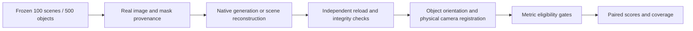

# Rigid Asset Model Comparison

Research code for comparing **native 3D rigid assets** on a frozen cohort drawn from **100 nuScenes scenes**. The cohort contains **500 assets: 432 vehicles and 68 non-vehicle assets**, evaluated across nine methods without converting every representation into a common surrogate model.

[中文说明](README_zh-CN.md) · [Data & inputs](docs/DATA.md) · [Reproduction](docs/REPRODUCING.md) · [Evaluation protocol](docs/EVALUATION.md) · [Release scope](docs/RELEASE.md) · [Incremental preparation](docs/PREPARATION.md)

> **Research release, 2026-11-11.** Asset generation and evaluation qualification are ongoing. This repository publishes numerical evaluation components, experiment adapters, and frozen membership metadata. It does **not** report a completed benchmark, provide pretrained checkpoints, or claim that the historical experiment can be reproduced end-to-end from this checkout alone. See the dependency and data limitations below.

## Overview

The experiment separates four questions:

1. **Input provenance:** which real images, masks, scene frames, and additional observations did each method consume?
2. **Native output integrity:** can the original output be independently reloaded and rendered without changing its representation?
3. **Coordinate consistency:** do the asset, object frame, camera, scale, and timestamp describe the same physical observation?
4. **Metric eligibility:** is the reference appropriate for the metric, and how many of the fixed 500 objects remain evaluable?



## Methods and input conditions

| Method ID | Method | Experimental input / output |
|---|---|---|
| `ours` | Existing asset pipeline | Existing native assets; historical inputs include generated imagery; see disclosure below |
| `ah` | Asset Harvester | Real source image/mask; native Gaussian asset |
| `trellis_original` | Original TRELLIS | One real RGBA image; native Gaussian output through the legacy Gaussian loader |
| `trellis2` | TRELLIS.2 | One real RGBA image; native voxel mesh and textured GLB |
| `hunyuan21` | Hunyuan3D 2.1 | One real RGBA image; native shape and texture pipelines |
| `recon02` | ReconViaGen v0.2 | Available eligible **real multi-view images**, no FLUX input; native Gaussian output |
| `splatad` | SplatAD | Scene reconstruction with recorded native observations; native actor rendering |
| `omnire` | OmniRe | Scene reconstruction with recorded native observations; native actor rendering |
| `streetgs` | Street Gaussians (DriveStudio implementation) | Frozen nuScenes scene inputs; native DriveStudio actor rendering |

**The methods do not have identical supervision.** External image-based methods reuse the pipeline's real source imagery/masks; ReconViaGen uses the available eligible real views. Scene methods consume additional observations and method-specific scene information. The existing `ours` cohort records **364 `flux_plus_real` and 136 `flux_only` assets**. These existing results are not an equal-real-input ablation. Input regimes must be disclosed in any comparison.

## Dataset scope

| Category | Count | Category | Count |
|---|---:|---|---:|
| car | 317 | truck | 78 |
| van | 31 | bus | 6 |
| barrier | 12 | pole | 12 |
| bollard | 11 | road_debris | 11 |
| cone | 9 | trash_can | 7 |
| hydrant | 6 | **Total** | **500** |

Membership is frozen by identifiers and hashes, not by duplicating image or asset files. The cohort was selected for asset availability and manual appearance acceptance; it is **not a random nuScenes sample**. Historical non-vehicle category names also require care when making category-level claims. Model failures never justify silently dropping objects from the frozen denominator.

## Quick start: CPU checks

Python 3.10 or newer is recommended. GPU model environments are separate from this small evaluation environment.

```bash
python -m venv .venv
source .venv/bin/activate
python -m pip install -r requirements-eval.txt
python scripts/validate_release.py
python -m unittest discover -s evaluation -p 'test_*.py' -v
```

The release also includes 10 mocked scheduling tests (no GPU required):

```bash
python -m unittest discover -s research_snapshot/model_preparation/20261109_2100_CST/scripts -p 'test_*.py' -v
```

The numerical tests use synthetic arrays and require no nuScenes data, weights, network access, or GPU. They check metric definitions, fixed reference crops, camera-frame invariance, reference geometry, and invalid-input handling. Passing these tests does not certify any generated asset or establish metric eligibility.

## Repository layout

```text
configs/             Public cohort, scene membership, artifact and metric metadata
evaluation/         CPU numerical metrics, camera/orientation contracts and tests
research_snapshot/  Project-authored native adapters and historical workflow code
scripts/            Public release validation
docs/               Input protocol, reproduction, metric definitions and limitations
provenance/         Original and published code hashes
```

The research snapshot preserves historical directory names so that code relationships remain inspectable. Deployment path literals were replaced with `RIGID_*` environment roots; model logic was retained. It is a research workflow reference, **not an automatic launch-on-import package**. It depends on local manifests, upstream repositories, licensed weights, CUDA extensions, and model-specific environments that are deliberately absent from Git.

## Evaluation policy

The evaluation distinguishes **source-view reconstruction**, **genuine real held-out views**, **feature similarity**, and **qualified surface geometry**. Common turntable previews are not evidence of physical camera registration. Gaussian centres are not a ground-truth surface. Missing eligibility is recorded as unavailable, not as a fabricated score.

See [the complete protocol](docs/EVALUATION.md) for CD, F1/Recall, IoU, PSNR, SSIM, LPIPS, I16, ED-R and Fréchet-distance definitions. Formal metric execution remains disabled in this release; final protocol choices and reference qualification are still pending.

## Reproduction status

- [x] Frozen 500-object and 100-scene public membership metadata
- [x] Numerical metric and camera/orientation regression tests
- [x] Native generation/reload and scene-adapter code snapshot
- [x] Input-regime and missing-data disclosure
- [ ] Self-contained end-to-end replay of every model from a clean machine
- [ ] Complete per-object physical registration and reference qualification
- [ ] Qualified reference surfaces and frozen geometry thresholds
- [ ] Final all-method benchmark tables

No GPU training, generation, or model download is performed by the CPU quick start. See [reproduction instructions](docs/REPRODUCING.md) before executing a research adapter.

## Attribution, licensing and citation

Upstream projects, datasets, and model weights retain their own licenses and access conditions. They are not bundled here. See [third-party notes](docs/THIRD_PARTY.md).

A license for the project-authored code has not yet been selected by the repository owner; this release does not grant an MIT/Apache license by implication. No paper title, author list, DOI, or BibTeX entry is fabricated. Until publication metadata is provided, reference this repository and the exact commit used in an experiment.
